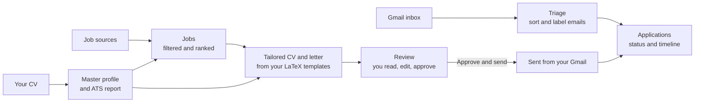

# JobPilot

**A job-search copilot that runs on your own computer.** JobPilot sorts the job emails in your
Gmail, tracks every application, checks your CV against applicant tracking systems (ATS), finds
and ranks job offers, and tailors your LaTeX CV and cover letter to each job. It sends an
application from your Gmail **only after you approve it**.

The interface is in French by default, with an English toggle.

- [How it works](#how-it-works)
- [Try the demo](#try-the-demo-no-account-needed)
- [Set up your own instance](#set-up-your-own-instance)
- [Everyday use](#everyday-use)
- [Safety model](#safety-model)
- [Limits to know](#limits-to-know)
- [Troubleshooting](#troubleshooting)
- [Development](#development)

## How it works



1. **Inbox triage.** Job-related emails are classified as Recruteur, Entretien, Refus, Offre,
   Newsletter or Autre, and labelled in Gmail under `JobPilot/`.
2. **Application tracking.** Each application has a status and a timeline. A reply in the thread
   of an application you sent is linked to it automatically.
3. **CV intelligence.** Your CV becomes a structured master profile that you can edit. An ATS
   report scores it and lists concrete fixes.
4. **Job discovery.** Offers from several sources are deduplicated, filtered and ranked against
   your profile.
5. **Application factory.** For a job, JobPilot tailors your CV and cover letter from your own
   LaTeX templates and compiles them to PDF.
6. **Review and send.** You read the documents, edit the email and click Approve and send.
   Nothing leaves without that click.

### Pages

| Page | What it does |
|---|---|
| Vue d'ensemble | KPIs, the application funnel, upcoming interviews, recent activity |
| Boîte de réception | Classified emails, with filters and manual re-classification |
| Candidatures | Kanban and table of applications, each with its timeline |
| Offres | Jobs with filters, a match score, save and hide |
| CV | Upload, the editable master profile, the ATS report |
| Templates | Your LaTeX CV and cover-letter templates, with a test compile |
| Revue | The checks, both PDFs, what the tailoring changed, the email, Approve and send |
| Sécurité | Items flagged for prompt injection, and the evaluation results |
| Utilisation | Language-model calls, tokens, cache hits and an estimated cost |
| Paramètres | Language, send limit, sending switch, signature, connection status |

## Try the demo (no account needed)

The demo runs the whole app on invented data in a separate database. It needs only Docker,
[uv](https://docs.astral.sh/uv/) and GNU make: no Google account and no API key.

```bash
git clone https://github.com/RanaRomdhane/jobpilot.git
cd jobpilot
make env        # creates .env with generated secrets
make password   # choose the dashboard password
make demo       # builds the stack, creates the demo database, loads the demo data
```

Open <http://localhost:3000> and sign in. A banner on every page shows that the data is
invented. In the demo, scheduled jobs are off, and buttons that call the language model need a
`GROQ_API_KEY` in `.env`.

- `make up` switches to your own data.
- `make demo-reset` reloads the demo data.

The first build downloads and builds a TeX Live image of about 3.7 GB, so it takes a while.

## Set up your own instance

**You need:** Docker (a 4 GB VM is enough), [uv](https://docs.astral.sh/uv/), Node 20 or later
with pnpm, and GNU make. On Windows, run the commands in Git Bash.

### 1. Start the stack

```bash
make install    # Python and web dependencies, git hooks
make env        # creates .env with a generated database password and encryption key
make password   # sets your dashboard password (only an Argon2 hash is stored)
```

Open `.env` and paste a Groq API key in `GROQ_API_KEY`. Keys are free at
<https://console.groq.com/keys>. Then:

```bash
make up         # builds and starts everything, and waits until it is healthy
```

- Dashboard: <http://localhost:3000>
- API documentation: <http://localhost:8000/api/v1/docs>

Everything listens on `127.0.0.1` only. PostgreSQL is published on port **5433**, so it does not
clash with a PostgreSQL installed on your machine.

### 2. Connect Gmail

1. Create a Google OAuth client, about 10 minutes:
   [docs/setup/google-oauth.md](docs/setup/google-oauth.md).
2. `make gmail-auth` opens Google's consent page. The token is stored encrypted.
3. `make triage` syncs the last 90 days and classifies them. After that, a sync and triage run
   every 30 minutes.

Triage only **reads** mail and **adds** `JobPilot/` labels. It never sends, deletes, archives or
forwards anything.

### 3. Add your CV and your LaTeX templates

1. **CV** page: upload your CV (PDF or DOCX), check the parsed profile and save it. This master
   profile is the only source of facts for tailored documents.
2. **Templates** page: upload your `.tex` CV and cover-letter templates, with any `.cls`, `.sty`
   or fonts. Run the conversion, check the preview and confirm the mapping.

### 4. Add job sources

The keyless sources work at once. For Adzuna and JSearch, add the keys described in
[docs/setup/job-sources.md](docs/setup/job-sources.md). Jobs are refreshed twice a day, and on
demand from the **Offres** page.

### 5. Allow sending (optional)

Sending is off until you turn it on, and it uses its own Gmail permission:

1. `make gmail-auth-send` grants a separate, send-only Gmail token. Sign in with the same Google
   account as triage.
2. In **Paramètres**, tick **Autoriser l'envoi des candidatures**.

## Everyday use

1. Open **Offres**, filter, and open a job you like.
2. Click **Générer le CV et la lettre**. Both documents are tailored and compiled in a sandbox.
   Each generation is kept as a new version.
3. Click **Vérifier et envoyer**. The **Revue** page shows the checks, both PDFs, what the
   tailoring changed, and the email. Edit what you want and save.
4. Click **Approuver et envoyer**, then confirm. The email leaves from your Gmail, the
   application is marked as sent, and replies in that thread are linked to it.

A posting without an application address shows its link instead. Apply on the employer's site
with the two PDFs, then click **J'ai postulé via le lien** so the application is tracked.

## Safety model

| Rule | How JobPilot enforces it |
|---|---|
| Your data stays local | PostgreSQL and files are on your machine. Only language-model calls leave it. |
| External text is never trusted | Emails, job posts and CVs pass an injection detector and reach the model as marked data, never as instructions. |
| Agents cannot act on your mailbox | The strongest thing an AI agent can do is add a `JobPilot/` label. |
| Every send needs you | Approve and send creates a one-time approval that expires in 10 minutes. Only the sender service can use it, with a Gmail token nothing else holds. |
| No invented facts | Employers, titles, dates and degrees are copied from your master profile. Every sentence the model wrote is checked against it, and failures are reverted or removed. |
| LaTeX cannot escape | Documents compile in a container with no network and no shell escape. |
| Sending is bounded | A daily cap (20 by default), and a block you must override when you already applied to the same role within 30 days. |

The full threat model is in [docs/security.md](docs/security.md).

## Limits to know

- **Read every tailored document before sending it.** The guardrail checks numbers, technical
  terms, a list of inflated claims and phrases copied from the posting. It cannot catch every
  awkward or inflated sentence. When it removes a sentence, the remaining text can read thin.
- **Groq's free tier is slow and capped.** JobPilot respects 8,000 tokens per minute and 200,000
  per day across all its processes. A generation can take a few minutes. When the daily budget is
  used up, an action ends with a clear message and nothing is lost. The **Utilisation** page
  shows where the tokens went.
- **Google tokens expire after 7 days** while your OAuth app is in Testing mode. When triage
  reports an expired sign-in, run `make gmail-auth` again, and `make gmail-auth-send` for
  sending.
- **Regenerating with nothing changed returns the same text** for up to 7 days, because answers
  are cached. Change the tone to get a new wording.
- **Some CV parts stay in the master profile's language**, such as job titles, degrees and skill
  group names.
- **A failed send is never retried automatically**, because Gmail may have sent it before the
  error. Approve it again if needed.
- **JobPilot is a single-user, local app.** Do not expose its ports to a network without adding
  TLS and reviewing the security model.

## Troubleshooting

| Symptom | What to do |
|---|---|
| `make up` shows no containers, or an empty app | The Docker CLI may point at another engine. `docker context ls` shows the active one, and `docker context use <name>` switches. Data lives in the engine where the stack was first started. |
| Port 3000, 8000, 5433 or 6379 is in use | Stop the other program, or change `POSTGRES_HOST_PORT` or `REDIS_HOST_PORT` in `.env`. |
| Changes to `.env` are ignored | `make restart` recreates the API and the worker. |
| Google sign-in fails on a scope | Add the scopes listed in [docs/setup/google-oauth.md](docs/setup/google-oauth.md) to the consent screen. |
| "Le budget quotidien du modèle de langue est épuisé" | The daily Groq budget is used up. It refills continuously over 24 hours. |
| A LaTeX compile fails | The Templates page shows the error log. The sandbox has no network, so every package must be in the image. |
| The app is very slow, or the database restarts | The machine is short on memory. Close other programs, and run only one Docker engine. |

`make logs s=worker` follows one service's log, and `make ps` shows the health of each service.

## Development

On a machine with little memory, run only the databases in Docker and the apps on the host:

```bash
make infra          # postgres and redis
make migrate-local
make api-dev        # terminal 1
make worker-dev     # terminal 2
make web-dev        # terminal 3
```

| Command | What it runs |
|---|---|
| `make check` | Lint, types and tests for Python and the web app |
| `make test-integration` | Python integration tests (needs `make infra`) |
| `make e2e` | Playwright journeys on an isolated stack with a stub language model and Gmail |
| `make eval` | Real-model evaluations: triage accuracy, injection precision and recall |
| `make gen-client` | Regenerates the typed TypeScript API client after an API change |
| `make revision m="..."` | Creates a database migration from the models |
| `make help` | Lists every target |

CI runs five checks on every pull request: Python (lint, types, tests), web (lint, types, tests,
build), the end-to-end journeys, a secret scan and the Docker builds.

### How it is built

| Layer | Choice |
|---|---|
| API | FastAPI, Pydantic v2, SQLAlchemy 2 async, Alembic |
| Background work | arq worker on Redis, with scheduled jobs |
| Database | PostgreSQL 16 with pgvector |
| Agents | OpenAI Agents SDK, Gmail tools through a custom MCP server |
| Language models | Groq by default, OpenAI as an option, behind one provider interface with a shared Redis rate limiter and a response cache |
| Embeddings | A local multilingual model, so no text leaves the machine for matching |
| Documents | Jinja2 with LaTeX-safe delimiters, TeX Live in a sandboxed container |
| Web | Next.js 15, TypeScript, Tailwind, shadcn/ui, TanStack Query, next-intl |

```
apps/      api (FastAPI) · worker (arq) · mcp_gmail · agents · web (Next.js)
packages/  core (config, models, LLM provider, rate limiter) · security · jobs_sources ·
           latex · resume
infra/     docker-compose files, Dockerfiles, the LaTeX sandbox, postgres init
scripts/   make_env, set_password, seed_demo
tests/     unit, integration, security and evaluation sets, end-to-end
docs/      architecture, security model, setup guides, decision records
```

## Documentation

- [Architecture](docs/architecture.md), with the system diagram
- [Security model](docs/security.md): threats, mitigations and residual risks
- [Gmail setup](docs/setup/google-oauth.md) and [job sources](docs/setup/job-sources.md)
- [Architecture decision records](docs/adr/)
- [Build brief](PROMPT.md) and [delivery plan](docs/plan.md)

## License

[MIT](LICENSE)
